# VECTOR STORM - A 2D Computer Graphics Shooter

[](https://github.com/amaansiddiqueacademics-a11y/vector-storm/actions/workflows/build.yml)
[](https://github.com/amaansiddiqueacademics-a11y/vector-storm/releases/latest)
[](LICENSE)


<p align="center">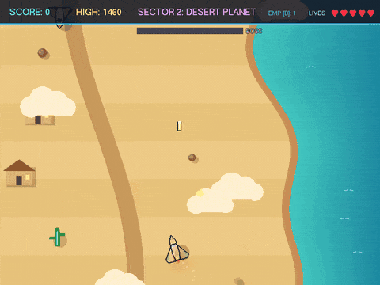</p>

A colourful, easy-to-read 2D plane shooter written in C++ with OpenGL and FreeGLUT. You fly a cartoon fighter plane over a different planet in every sector, shoot waves of enemy planes, collect power-ups and beat a boss to move on. Every picture is drawn in code (polygons, triangles, circles and lines) - there are no image files, and the sound is synthesised too.

The game doubles as a Computer Graphics project: the main menu has three learning screens.

- **HOW TO PLAY** - the rules, with the real enemy sprites and power-up badges.
- **HOW IT WORKS (CODE)** - 10 pages of real code from this game, shown with line numbers and explained line by line (game loop, movement, shooting, enemies, hit detection, score, drawing the plane, the scrolling world, power-ups and boss, project map).
- **CG CONCEPTS** - the list of graphics techniques used and where they live.

The main menu also has a **LEADERBOARD** with your top 10 runs, which are saved between games.

## Quick start (Windows)

1. Download **`VectorStorm-...-windows.zip`** from the [latest release](https://github.com/amaansiddiqueacademics-a11y/vector-storm/releases/latest).
2. Extract it and double-click **`game.exe`**.

Keep `libfreeglut.dll` in the same folder; nothing else needs to be installed (works on a clean Windows 10/11 PC). You can also clone the repository and run the `game.exe` in it.

## Screenshots

| | |
| :---: | :---: |
| 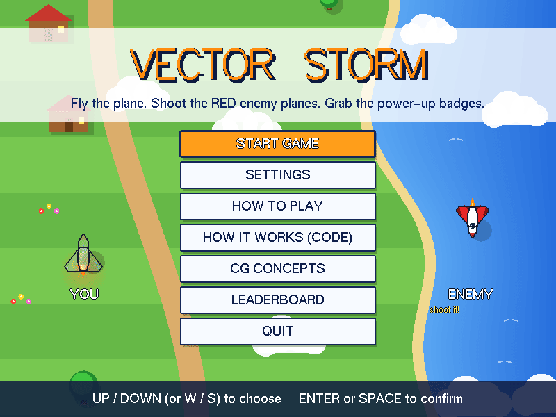 | 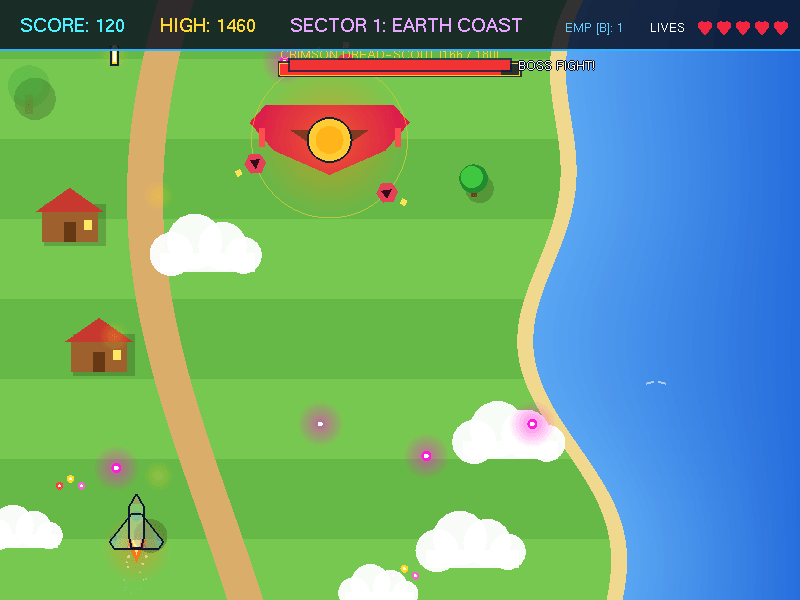 |
| Main menu | Sector boss |
| 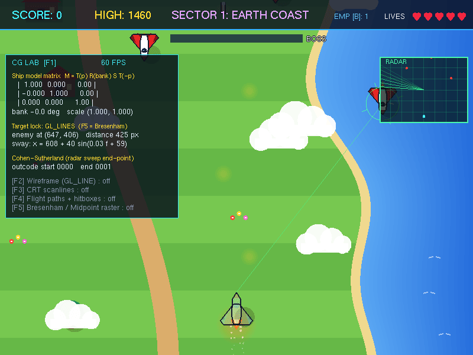 | 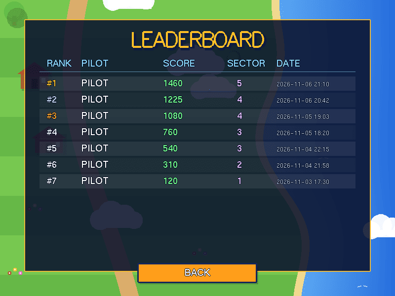 |
| F1 CG Lab panel: live model matrix, target lock, radar | Saved top-10 leaderboard |
| 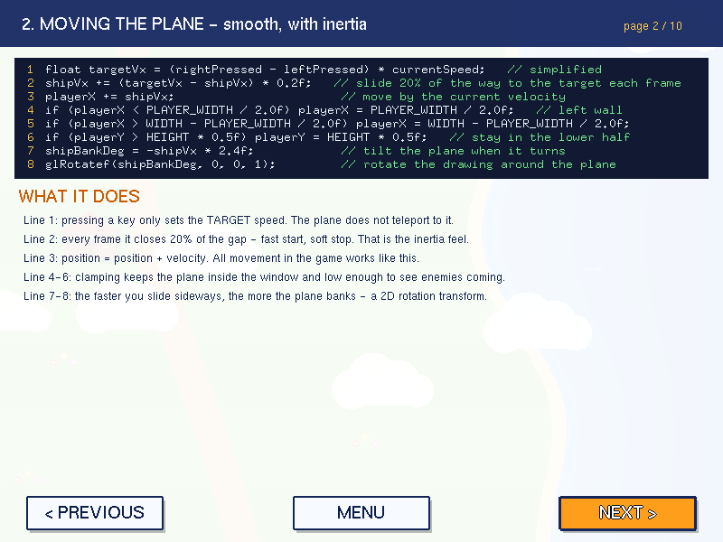 | 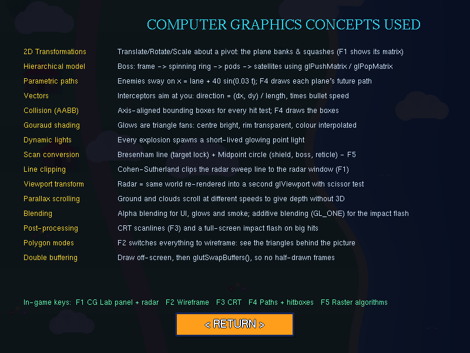 |
| HOW IT WORKS: the game's own code, explained | CG CONCEPTS used in the game |

**The five planets**

| 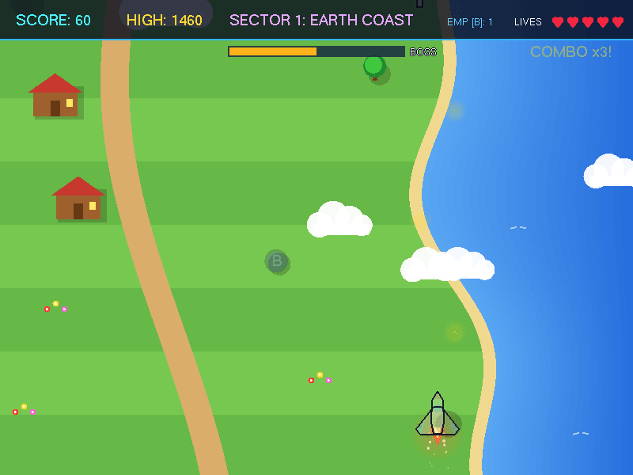 | 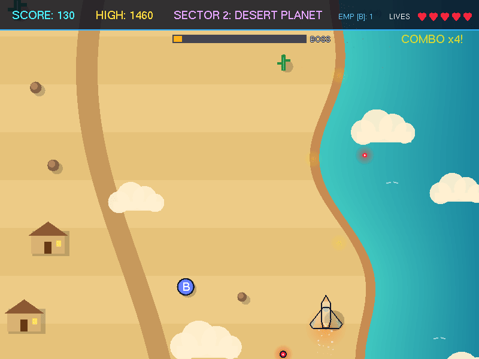 | 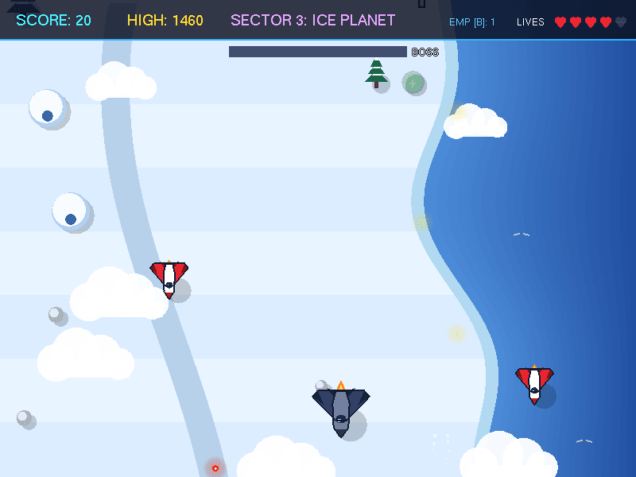 | 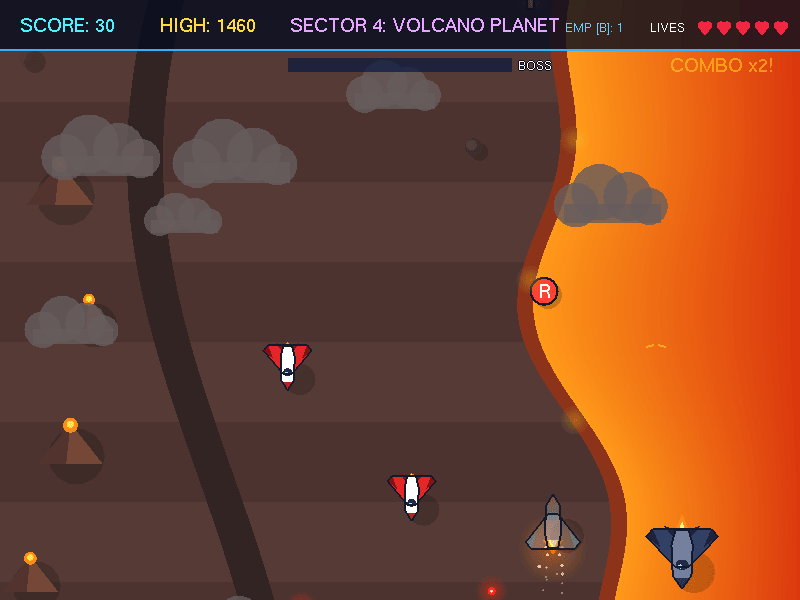 | 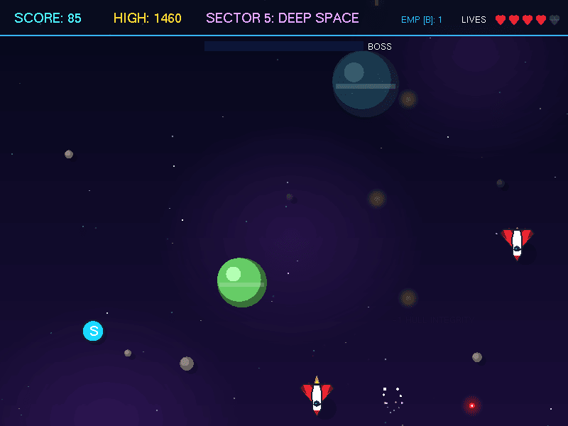 |
| :---: | :---: | :---: | :---: | :---: |
| 1. Earth coast | 2. Desert | 3. Ice | 4. Volcano | 5. Deep space |

## How to play

- **Goal:** shoot enemy planes to score. Fill the **BOSS** bar at the top, beat the boss, and fly on to the next planet.
- **You lose a heart** (you have 5) if a red bullet hits you, an enemy plane hits you, or an enemy **reaches the ground**.
- **Your combo** grows (up to x5) when you shoot planes quickly one after another. It resets when you are hit or an enemy lands.
- **Dash** with `Shift` to burst out of trouble: you are invulnerable for 0.3 s (1.2 s cooldown).
- A short hint bar at the bottom explains the controls for the first 15 seconds of every game.

### Enemies

| Enemy | Look | Behaviour | Points |
| :--- | :--- | :--- | :--- |
| Scout | White body, red wings | Flies straight down, shoots straight down | 10 |
| Interceptor | Yellow and orange | Fires shots **aimed** at your plane | 25 |
| Bomber | Big, blue-grey, 2 hits (smokes after the first) | Fires a 3-bullet fan | 35 |

Enemies spawn in small waves (3 to 5 planes). They are spread over random lanes and different heights, so they never fly in a straight line side by side. They always fly **forward** (down the screen) faster than the ground scrolls. A new wave arrives when the screen is clear.

### Planets (sectors)

| Sector | World | Scenery |
| :--- | :--- | :--- |
| 1 | Earth coast | Grass, sea, winding path, trees, houses, boats |
| 2 | Desert planet | Sand, oasis lake, cacti, huts, rocks |
| 3 | Ice planet | Snow, frozen sea, pines, igloos, icebergs |
| 4 | Volcano planet | Ash ground, lava river, volcanoes, dark rocks |
| 5 | Deep space | Twinkling stars, nebula, ringed planets, asteroids |

Beating a sector boss gives a free shield and an EMP bomb and starts the next planet. After sector 5 the planets repeat with higher score targets.

### Power-ups (round lettered badges dropped by enemies)

| Badge | Effect |
| :--- | :--- |
| S | Shield: absorbs 3 hits |
| 3 | Triple shot (about 11 s) |
| 5 | Five-way shot (10 s) |
| R | Rapid fire (10 s) |
| W | Speed boost (12 s) |
| B | +1 EMP bomb |
| T | Slow-motion enemies (8 s) |
| + | +1 life (max 5) |

## Controls

| Action | Keys |
| :--- | :--- |
| Move | Arrow keys or `W` `A` `S` `D` |
| Fire | Hold `Space` |
| Dash (short burst, brief invulnerability) | `Shift` |
| EMP bomb (clears enemy bullets, hurts everything) | `B` |
| Pause / resume | `P` or `Esc` |
| Quick restart | `R` |
| Fullscreen on / off | `F11` |
| Menus | Up/Down or `W`/`S`, `Enter` or `Space` to confirm, or click with the mouse |
| HOW IT WORKS pages | Left/Right arrows or `A`/`D` (or the PREVIOUS / NEXT buttons), `Esc` for the menu |

Developer toggles during play: `F1` CG Lab panel (with radar and target lock), `F2` wireframe, `F3` CRT scanlines, `F4` enemy flight paths + hit boxes, `F5` software raster algorithms (Bresenham line, midpoint circle).

## Saved data

The game creates two small text files next to `game.exe`:

| File | What is in it |
| :--- | :--- |
| `scores.dat` | Top 10 scores: `PILOT\|score\|sector\|date`, one per line |
| `settings.cfg` | Volumes, screen shake and ship colour (saved when you leave SETTINGS or quit) |

Delete them to reset the leaderboard or settings. A missing or damaged file is simply ignored. Both are listed in `.gitignore`, so your scores are never committed.

## Building from source

The source list is the same in all three build files: `main.cpp` plus every `.cpp` under `src/`.

### Windows (MSYS2 / MinGW-w64)

Install [MSYS2](https://www.msys2.org/), then in the **UCRT64** shell:

```sh
pacman -S mingw-w64-ucrt-x86_64-gcc mingw-w64-ucrt-x86_64-freeglut
```

Then from PowerShell or CMD in this folder:

```powershell
.\build.bat run     # compile and launch
.\build.bat         # compile only
.\build.bat clean   # remove game.exe
```

`make` (from the MSYS2 shell) and CMake work too. The C++ runtime and winpthread are linked statically, so the resulting `game.exe` only needs `libfreeglut.dll`.

### Linux

```sh
sudo apt install g++ make freeglut3-dev      # Debian / Ubuntu
make run
```

or with CMake: `cmake -B build && cmake --build build && ./build/game`.

Sound uses the Windows WinMM API, so on Linux the game runs silently; everything else works the same.

## Project structure

```text
vector-storm/
  main.cpp                          Game logic: game loop, input, HUD, menus, leaderboard, planes, waves, boss
  src/Core/SaveSystem.cpp           Leaderboard (scores.dat) and settings (settings.cfg) persistence
  src/Graphics/Starfield.cpp        The scrolling 2D worlds (5 planets) and the sector table
  src/Graphics/Renderer.cpp         Text and circle drawing helpers (outlined text, stroke title)
  src/Graphics/ParticleSystem.cpp   Explosions, smoke trails, floating score text
  src/Graphics/CGLab.cpp            Glow and lights, Cohen-Sutherland clipping, Bresenham/midpoint raster, post effects
  src/Entities/Powerup.cpp          Power-up badges: spawn, fall, draw
  src/Audio/SoundEngine.cpp         Procedural sound effects and music (WinMM on Windows)
  include/                          Headers (Config.hpp holds window size and game states)
  build.bat, Makefile, CMakeLists.txt   Build files
  ROADMAP.md                        What is done and ideas for later
  game.exe, libfreeglut.dll         Ready-to-run Windows build
  docs/screenshots/                 Images used in this README
  .github/workflows/build.yml       Automatic Windows + Linux builds, and releases
  VERSION                           Version number; bump it to publish a release
```

### Game loop

`update()` uses a **fixed timestep**: it measures real elapsed time and runs `simulateFrame()` once for every 1/60 s that has passed. All speeds and timers are written per frame at 60 FPS, so the game runs at the same speed on every PC and monitor. The old loop simply re-armed `glutTimerFunc(16, ...)`, so any timer that fired late (Windows' default timer resolution is about 15.6 ms, and a busy PC adds more) slowed the whole game down.

## Tuning the game

- **Difficulty:** `spawnWave()` in `main.cpp` (wave size, enemy speed, lanes); the `shootTimer` code in `simulateFrame()` (how often enemies fire); `spawnBoss()` (boss health).
- **Sector goals:** the boss score, scroll speed and music tempo of each planet in the `sectorThemes` table in `Starfield.cpp`, and `sectorTargetScore()` in `main.cpp`.
- **Dash:** `DASH_COOLDOWN_FRAMES`, `DASH_IFRAMES` and `tryDash()` in `main.cpp`.
- **Look:** `drawPlayer()` and `drawEnemyPlane()` for the planes; the palette table and scenery functions in `Starfield.cpp` for the worlds.

See [ROADMAP.md](ROADMAP.md) for what is done and what could come next.

## Releases

Every push to `main` is built automatically on Windows (MSYS2) and Linux by [GitHub Actions](.github/workflows/build.yml).

To publish a new downloadable version, change the number in the [`VERSION`](VERSION) file (for example `1.1.0`) and push to `main`. The workflow builds the game and creates release `v1.1.0` with `VectorStorm-v1.1.0-windows.zip` (game.exe, libfreeglut.dll, README, LICENSE). Pushing a tag such as `v1.1.0` works too. A version that already has a release is never published twice.

## Team

| Member | Contributions |
| :--- | :--- |
| **Amaan Siddique** | Merged the redesign and save-system branches, build and bug fixes, code cleanup, CI and releases |
| **Sairaj Khandagale** | Original game and core systems (audio, graphics, power-ups, particles, sectors), save system, leaderboard |
| **Abdul Hakim Shaikh** | Cartoon 2D redesign: planet sectors, readable menus, wave enemies, HOW IT WORKS code walkthrough screens |

## License

[MIT](LICENSE) - free to use, change and share, as long as the copyright notice stays in. `libfreeglut.dll` is [FreeGLUT](https://freeglut.sourceforge.net/), under its own MIT/X11-style license.
